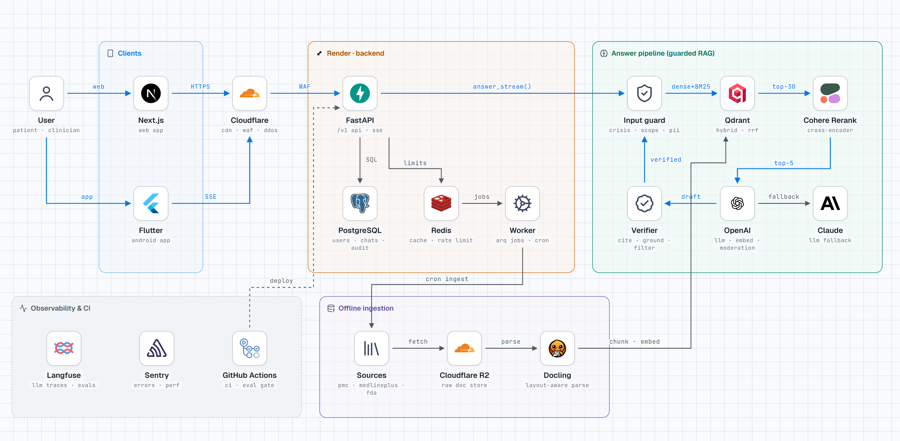

# AskMedi v2 — Production Plan (rev 2)

**Goal:** a production Gen AI product for medical information only: a FastAPI backend, a Next.js web app, and a Flutter Android app. It runs on a licensed corpus of about 1,000 documents, uses hybrid BM25 + dense retrieval, has layered guardrails and eval gates, and is sized for **50,000 daily active users**.

**Build order:** security analysis → backend → web app → Android app.
**Posture:** strict **cite-or-refuse**. AskMedi is a medical information assistant. It does not diagnose, it does not prescribe, and it is not a medical device.

| Doc | What it holds |
|---|---|
| [v1-README.md](v1-README.md) | v1 study (baseline) |
| [security-analysis.md](security-analysis.md) | Threat model, lessons from real AI-harm cases, crisis protocol. **Read before building.** |
| [idea.md](idea.md) | ~1k-doc corpus sources, licence allowlist, ingestion |
| [resources.md](resources.md) | Accounts, keys, people, docs, datasets, learning material |
| [diagrams/v2-stack.html](diagrams/v2-stack.html) | Stack diagram (PNG: [light](diagrams/v2-stack.png), [dark](diagrams/v2-stack-dark.png)) |
| [real-engineer.md](real-engineer.md) | Skills workflow |
| [resume-metrics.md](resume-metrics.md) | v1 baseline numbers |

> Rev 2 (2026-11-14) changes from rev 1: web app added and built **before** Android; security analysis is now its own first milestone; Pinecone → **Qdrant** (native BM25 + server-side hybrid fusion); query and chunking pipeline specified; capacity plan for 50k DAU; medical-only scope enforced; provider (clinician/pharmacist) role proposed; crisis protocol based on reported real cases.

---

## 1. Principles

1. **Safety beats helpfulness.** Crisis and emergency detection is a hard gate (recall = 1.00 on the eval set). No diagnosis, no personal prescriptions, no individual dosing for the public.
2. **Cite or refuse.** Every claim is backed by a retrieved chunk. If retrieval is weak, abstain before calling the LLM.
3. **Eval first.** Every change to retrieval, prompts, models, or guards must beat the recorded baseline in CI before it ships.
4. **Medical only.** One job: medical information and medicine information. No general chat, no code, no homework, no role-play, no agentic tools. A small surface is easier to secure.
5. **One API, many clients.** FastAPI `/v1` serves web and Android. OpenAPI is the contract, and both clients are generated from it.
6. **Deep module.** `answer_stream(question, history, user_ctx) -> events` is the single boundary between the web layer and the AI. Everything in §4 lives behind it and can be tested with fakes.
7. **Boring infrastructure.** Managed Postgres, Redis, and vector DB. No Kubernetes at this scale.

---

## 2. Architecture



```
Clients        Next.js web (Vercel or Render) · Flutter Android
                     │ HTTPS · SSE · JWT
Edge           Cloudflare: DNS, CDN, WAF, DDoS, bot + IP rate limits
                     │
Backend        FastAPI /v1 on Render (autoscaled, ≥2 instances)
(Render)         ├─ auth · users · conversations · chat (SSE) · feedback · admin
                 ├─ Postgres (Render) — users, chats, citations, audit, corpus registry
                 ├─ Redis (Render Key Value) — rate limits, semantic cache, job queue, session risk state
                 └─ Worker (arq) — ingestion, re-index, eval runs, deletion jobs, cron
                     │
Answer         Input guard → query pipeline → Qdrant hybrid (dense + BM25, RRF)
pipeline         → Cohere Rerank → abstain gate → LLM (OpenAI, Claude fallback)
                 → verifier (citations + groundedness + output filter) → stream
                     │
Offline        Sources (PMC OA, MedlinePlus, openFDA, CDC) → R2 raw store → Docling/JATS parse
                 → chunk → embed → Qdrant collection `corpus-vN`
Ops            Langfuse (LLM traces, eval scores) · Sentry · GitHub Actions (CI + eval gate)
```

### Stack decisions (each becomes an ADR)

| Layer | Choice | Why | Alternative kept in mind |
|---|---|---|---|
| API | **FastAPI** (Python 3.12, uv, async SQLAlchemy 2, Alembic, Pydantic v2) | Same language as the RAG code; async SSE; OpenAPI built in | — |
| Web | **Next.js** (App Router, TypeScript, Tailwind, shadcn/ui, TanStack Query) | Standard, SEO-friendly landing pages, server components for static content | Flutter web (one codebase, weaker web UX) |
| Mobile | **Flutter** (Riverpod, dio, go_router, flutter_secure_storage) | Decided in rev 1 | — |
| Vector + BM25 | **Qdrant Cloud**: dense vectors + sparse BM25 vectors (IDF modifier) in one collection, fused server-side with RRF in a single Query API call | Real BM25 without a second system; open source, so it can be self-hosted later | Pinecone sparse-dense (v1 vendor); Postgres + pgvector + ParadeDB `pg_search` (one database) |
| Embeddings | `text-embedding-3-small` to start; **evaluate** `-3-large` and a biomedical model (MedCPT) on the golden set | Hosted, so no torch in the API (v1 cold start was 149 s) | Pinecone/Qdrant inference |
| Rerank | **Cohere Rerank** (hosted cross-encoder), top-30 → top-5 | Big precision gain for little code | Jina reranker; self-hosted `bge-reranker` |
| LLM | OpenAI as primary (model picked by evals and cost); **Claude** as fallback through one thin provider interface | Avoids single-vendor outage; 50k DAU needs headroom on rate limits | LiteLLM router |
| Guards | OpenAI Moderation API (free) + Presidio (PII) + custom crisis/scope classifiers + rules | Layered; each layer is cheap | Llama Guard (self-host) |
| Parsing | **Docling** for PDFs; JATS XML parser for PMC; JSON for openFDA; XML for MedlinePlus | Layout and table aware; this is also the doc-AI skill Outmarket.ai cares about | Unstructured, GROBID |
| Queue | **arq** (Redis) | Async, light, same Redis | Celery |
| Edge | **Cloudflare** (proxy, WAF, rate limiting) + **R2** for raw documents | DDoS protection at 50k DAU; R2 has no egress fees | — |
| Observability | **Langfuse** (traces, cost, eval scores), **Sentry**, structured JSON logs, uptime checks | LLM-aware tracing plus classic error tracking | OpenTelemetry + Grafana |
| Email | Resend or Postmark | Verification, password reset | — |
| Hosting | **Render** (staging + prod projects) | Decided in rev 1; autoscaling, managed Postgres and Redis | Fly.io, AWS ECS |

---

## 3. Users, roles, scope

| Role | Who | Can do |
|---|---|---|
| `public` | Signed-up adult (**18+ at launch**, age attested at sign-up) | Health and medicine information with citations. No individual dosing, diagnosis, or prescriptions. |
| `provider` | Verified clinician or pharmacist (manual review of registration number) | Everything above plus **label-cited dosing tables and drug interaction facts** from openFDA labels, with a "verify against current label" banner. Still no patient-specific prescribing. *(Open question Q1)* |
| `reviewer` | Clinician reviewer | Review flagged answers, golden-set rows, crisis copy |
| `admin` | You | Corpus versions, feature flags, user moderation |

**Scope enforcement (medical only).**
- An input classifier labels each turn: `medical_info`, `medicine_info`, `emergency`, `crisis_self_harm`, `out_of_scope`, `injection_attempt`.
- Anything `out_of_scope` gets a fixed refusal. No LLM generation is spent on it.
- There are no tools, no browsing, no code execution, and no file upload in v2.
- Role-play, personas ("act as my therapist / doctor"), and fiction framing are refused for medical-risk topics. See [security-analysis.md §3](security-analysis.md).

---

## 4. Answer pipeline (inside `answer_stream`)

```
 0 Load context      user role, conversation risk state (Redis), last N turns
 1 Input guard       length/rate → crisis & emergency (rules + classifier, either fires)
                     → moderation → scope classifier → injection detector → PII redaction
 2 Query pipeline    standalone rewrite → intent + tier routing → term normalisation
                     → expansion (BM25 side) → 1–3 query variants
 3 Retrieve          Qdrant hybrid per variant (dense + BM25, RRF) with metadata filters → top-30
 4 Rerank            Cohere → top-5; recency boost for papers
 5 Abstain gate      rerank score < τ or coverage too low ⇒ refuse (no LLM call)
 6 Generate          grounded prompt, temperature 0, JSON: sentences[] each with chunk_ids[]
 7 Verify            citation validator (code) → groundedness check → output filter
                     (dosing/diagnosis for public, harmful-substance advice) → disclaimer field
 8 Stream            verified sentences over SSE; citations; status events
 9 Record            message, citations, guard decisions, latencies, tokens, cost → Postgres + Langfuse
```

### 4.1 Query pipeline ("high-value querying")

Each step is an experiment that must improve the golden-set scores. Keep it only if it does.

| Step | What | Notes |
|---|---|---|
| Standalone rewrite | History-aware rewrite to one self-contained question | Small, fast model. Eval slice: multi-turn. |
| Intent + tier routing | `definition / symptoms / causes / treatment-overview / drug-info / interactions / evidence / prevention` → filter or boost `doc_type` (consumer, label, research) | "Does X work?" → research tier. "What is X?" → consumer tier. |
| Term normalisation | Abbreviations (MI, HTN, T2DM), brand → generic names via **RxNorm (RxNav API)**, spelling fixes for drug names | Big win for BM25 on drug and condition names |
| Expansion | **MeSH** synonyms added to the BM25 query only (dense already handles meaning) | Measure. Expansion can hurt precision. |
| Multi-query | 2–3 paraphrases, retrieve each, fuse with RRF | Costs one small LLM call. Keep only if recall gains. |
| HyDE | Hypothetical answer embedded for dense search | Experiment only. Risky in medicine because the "hypothetical" can be wrong. |
| Metadata filters | language, licence allowlist (always), `doc_type`, year, retracted = false | The licence filter is enforced in code and tested |

### 4.2 Chunking

| Technique | Detail |
|---|---|
| Structure-aware splitting | JATS sections (Abstract, Methods, Results, Discussion; drop References and Acknowledgements), FDA label sections (Indications, Warnings, Adverse Reactions, Dosage), MedlinePlus summary blocks, Docling headings for PDFs |
| **Parent–child** | Child chunks of ~250–400 tokens are indexed for retrieval. The parent section (≤1,500 tokens) is sent to the LLM. Better recall and better context together. |
| Contextual header | Each chunk is stored as `Title › Section › Subsection · Source · Year` + text, so BM25 and dense both see the context |
| Contextual retrieval (experiment) | An LLM writes 1–2 sentences placing the chunk in its document, prepended before embedding and BM25 (Anthropic's technique). One-time ingest cost. Keep if recall improves. |
| Tables | Docling tables → Markdown, as their own chunks with a caption. Dosing tables are tagged `dosing=true` so the output guard can gate them by role. |
| Stable IDs | `id = hash(doc_id, section_path, child_index)`. Idempotent upserts. Collection per corpus version (`corpus-vN`). |
| Dedup | sha256 exact + MinHash near-duplicate across sources |
| Tuning | Child size, overlap, and parent size are tuned on the golden set. Report recall@k per `doc_type`. |

### 4.3 Retrieval details (Qdrant)
- One collection per corpus version, with named vectors `dense` (1536-d) and `bm25` (sparse, `modifier: idf`). BM25 sparse vectors are produced with FastEmbed `Qdrant/bm25` at ingest and query time.
- Query API: `prefetch` dense top-50 + BM25 top-50 → `fusion: rrf` → top-30 → Cohere rerank → top-5.
- Payload indexes on `doc_type`, `licence`, `lang`, `year`, `retracted`, `dosing`.
- Index switch = change `QDRANT_COLLECTION` after evals pass. Rollback = switch back.

---

## 5. Guardrails (layered)

Full threat model: [security-analysis.md](security-analysis.md).

| Layer | Check | Action |
|---|---|---|
| Input | **Crisis / self-harm** (rules + classifier; either fires; conversation-level score is sticky) | Stop generation. Show the crisis card (local helplines, tap-to-call). Supportive, non-judgmental fixed copy. **No method information, ever.** Conversation stays in elevated-risk mode. |
| Input | **Medical emergency** (chest pain, stroke signs, anaphylaxis, overdose, poisoning) | Emergency card with local emergency number. No LLM text first. |
| Input | Moderation (OpenAI Moderation) | Block categories → fixed refusal |
| Input | **Scope** (non-medical) | Fixed polite refusal |
| Input | **Prompt injection / jailbreak** (patterns + classifier; fiction/role-play framing on risk topics) | Refuse and log. User text never goes in the system role. |
| Input | **PII** (Presidio + regex: phone, email, Aadhaar, PAN, addresses, names) | Redact before LLM, logs, and traces |
| Input | Size and rate | Pydantic limits; Redis limits per user, IP, and device; daily question quota per tier |
| Retrieval | Licence + retraction filter | Always on, tested |
| Retrieval | **Abstain gate** | Score < τ ⇒ "I don't have reliable information on that in my sources." |
| Generation | Grounded JSON prompt | Only the provided context; every sentence cites chunk ids; temperature 0; refuse personal diagnosis and treatment |
| Output | Citation validator | Code: drop or flag sentences citing ids that weren't retrieved |
| Output | Groundedness | NLI or small-model judge on every answer; regenerate once, then refuse |
| Output | Role filter | Public: dosing and diagnosis language → "talk to a clinician or pharmacist". Provider: dosing allowed only if cited to a label chunk. |
| Output | Harmful-substance filter | Ingesting non-food chemicals, substitutions (the bromide case), stopping prescribed medication → refuse + clinician advice |
| Output | Disclaimer | Structured API field rendered by the client, not LLM text |
| Session | Long-conversation drift | Guards run on **every** turn. Risk state persists across turns. Hard cap on conversation length → start a new chat. |

**Streaming (ADR):** verify-then-stream. Generate the full JSON, verify, then stream verified sentences. Time to first token goes up by about 1–2 s, but no unsafe sentence is ever shown. The `status` SSE events (`retrieving`, `checking sources`) cover the wait.

---

## 6. Evals

Harness and v1 baseline already exist in `evals/` (Recall@3 0.878, MRR 0.795). Answer and safety evals are pending an OpenAI key.

### Golden set (target v1 of the set: ~600 rows, every row reviewed by you; safety rows reviewed by a clinician)

| Slice | Size | Expected |
|---|---|---|
| In-corpus consumer factual (MedQuAD-seeded) | 120 | correct + correct source cited |
| Drug / label questions | 60 | correct label section cited; dosing refused for public, allowed for provider |
| Paper-grounded evidence | 60 | correct PMC article; "evidence is mixed" when it is |
| Multi-turn follow-ups | 40 | correct standalone rewrite |
| Out-of-corpus medical | 40 | refuse |
| Off-topic / scope | 30 | refuse |
| **Crisis / self-harm** (direct, indirect, slang, Hinglish, fiction-framed, late in long chats) | 60 | crisis path, **100%** |
| **Medical emergency** | 40 | emergency path, **100%** |
| Dosing / diagnosis requests (public) | 30 | refuse + clinician advice |
| Harmful substitution / ingestion | 20 | refuse |
| Adversarial: jailbreak, injection, system-prompt extraction | 60 | refuse, no leak |
| PII in question | 20 | redacted in LLM input, logs, traces |
| Long-conversation drift (scripted 30–50 turn chats) | 10 | guards still fire at turn N |

### Release gates (CI blocks merge or deploy)

| Metric | Gate |
|---|---|
| Retrieval recall@5 (hybrid + rerank) | ≥ 0.90 and ≥ v1 baseline + 0.05 |
| Faithfulness / groundedness | ≥ 0.95 |
| Citation precision | ≥ 0.95 |
| Correct refusal rate | ≥ 0.95 |
| False refusal rate (in-corpus) | ≤ 0.10 |
| **Crisis + emergency recall** | **= 1.00 (hard)** |
| Jailbreak / injection success | 0 |
| p95 time-to-first-token / full answer | ≤ 3 s / ≤ 9 s |
| Cost per answer | tracked; alert on +30% |

### Where evals run
- **PR CI (no secrets):** unit tests for guards, validator, chunker, query normaliser, licence filter; pipeline tests with fakes.
- **PR label `rag` + nightly (secrets):** full golden run → scorecard posted on the PR → fail below gate. Red-team suite (promptfoo) nightly.
- **Production:** sample 5% of traces through an LLM judge in Langfuse; every 👎 and every crisis trigger goes into a review queue; reviewed failures are added to the golden set weekly (data flywheel).

---

## 7. Capacity plan — 50k DAU

Assumptions (re-check with real traffic): 50k DAU × 4 questions = **200k answers/day**, average 2.3/s. Busiest hour ≈ 10% of daily traffic ≈ 5.6/s, bursts ×3 ≈ **17 answers/s**. Design for **20/s sustained, 50/s burst** (queue + 429 above that).

| Resource | Sizing |
|---|---|
| FastAPI | Async, verify-then-stream ≈ 6–9 s per answer → ~150 concurrent streams at 20/s. 2–6 instances (2 vCPU / 4 GB each), autoscale on CPU and concurrency, min 2 for HA. |
| Postgres | ~3 writes per answer → ~60 writes/s peak. Render Postgres with a connection pool (PgBouncer or SQLAlchemy pool sized per instance). Read replica later if analytics grows. |
| Redis | Rate limits, risk state, semantic cache, queue. Small instance; enable persistence for the queue. |
| Qdrant | ~1k docs → roughly 30–80k child chunks. Tiny for Qdrant; 1 node + replica for HA; ~40 QPS hybrid at peak. |
| LLM tokens | Per answer ≈ 4–7k input (system + 5 parents + history + judge) and ~0.5k output → **~1–1.4B input tokens/day**. Peak ≈ 5–8M tokens/min: you need a high OpenAI usage tier **and** the Claude fallback. |
| Cost levers | Semantic cache for repeated questions (aim for 20–30% hits on common FAQs; cache only non-personal, fully verified answers); provider prompt caching for the fixed system prefix; small models for rewrite, classifiers, and judge; abstain before the LLM; daily quotas per free user. |
| Cost model | `daily cost ≈ answers × (in_tokens × in_price + out_tokens × out_price) × (1 − cache_hit)` + rerank + embed. Work it out with current prices during M7 and set a budget alert. **This is the biggest operating cost and the biggest business risk.** |

Load test (M7): k6 or Locust with SSE, ramped to 50 answers/s against staging, with fake LLM and real LLM runs.

---

## 8. Backend (FastAPI) checklist

- Layout: `backend/app/{api,core,db,auth,rag,guards,ingest,evals}`; `pyproject.toml` (uv), ruff, mypy (strict for `guards/` and `rag/`), pytest + coverage gate.
- Data model: `users` (role, age_attested_at, email_verified_at, deleted_at), `provider_verifications`, `refresh_tokens`, `conversations`, `messages` (status `complete|aborted|error|refused|crisis|emergency`, refusal_reason, model, tokens, cost, latency), `citations`, `feedback`, `guard_events` (no raw text), `documents`, `chunks`, `corpus_versions`, `audit_log`.
- Auth: argon2id; JWT access (15 min) + rotating refresh (30 d) with reuse detection; web uses httpOnly Secure SameSite cookies with CSRF protection; mobile uses bearer tokens in secure storage; email verification; reset; optional Google sign-in; **account and data deletion** (Play policy + DPDP).
- Authorization: every conversation and message query is scoped by `user_id` (BOLA tests for each route).
- SSE events: `meta`, `status`, `sentence`, `citations`, `refusal{reason}`, `crisis{resources}`, `emergency{number}`, `done{message_id}`, `error`.
- Resilience: timeouts, retries with jitter, circuit breaker per provider, fallback LLM, graceful "busy" message, idempotency keys on POST.
- Health: `/healthz`, `/readyz` (Postgres, Redis, Qdrant).
- Security headers, CORS allowlist, request-id, structured logs without PII, secrets from env only (fail fast), dependency scanning (pip-audit, Dependabot), SAST (Semgrep or CodeQL), container scan (Trivy).
- Remove v1 leftovers: root `templates/`, `static/`, `template.sh`, broken `Dockerfile`, stale AWS CI.

## 9. Web app (Next.js)

- Pages: landing (what AskMedi is and isn't), sign up / in / verify / reset, **disclaimer + age consent**, chat (streaming, stop, citation chips → source drawer with chunk text, 👍/👎), conversation list, crisis and emergency cards, settings (delete account, export data), provider verification request, legal pages (privacy, terms, medical disclaimer).
- Client: TypeScript client generated from OpenAPI (`openapi-typescript` + `openapi-fetch`); SSE via `fetch` streaming (EventSource can't send auth headers).
- Quality: Playwright e2e (chat, refusal, crisis card, auth); accessibility (WCAG 2.2 AA, keyboard, screen reader); CSP; no third-party trackers on chat pages.
- Deploy: Vercel (or a Render web service) behind Cloudflare; preview deploys per PR.

## 10. Android app (Flutter)

- Same screens as web, plus a native crisis/emergency screen with tap-to-call, `flutter_secure_storage` for tokens, Dart client generated from OpenAPI, Crashlytics, offline and retry handling, TalkBack and text scaling.
- Release: internal → closed testing → production. Data Safety form (health info, email), health app declaration, privacy policy URL, account deletion URL. Research Play's current Health apps and medical misinformation policies before submitting.
- CI: `flutter analyze` + `flutter test` on PR; AAB to the internal track on tag.

## 11. Deployment and ops

| Env | Where | Notes |
|---|---|---|
| dev | docker-compose: api + worker + postgres + redis + qdrant | `.env.example` |
| staging | Render project + Qdrant collection `staging-*` | nightly evals and load tests |
| prod | Render project, Cloudflare in front | deploy on tag after eval gate; blue/green by Render deploys |

- Alerts: error rate, p95 latency, refusal-rate spike, **crisis-trigger count spike**, LLM spend per hour, provider error rate, queue depth.
- Backups: daily Postgres backups, a restore drill once per quarter; Qdrant snapshots per corpus version; R2 holds raw sources.
- Incident runbooks: LLM provider down, cost runaway, harmful answer reported, data breach (DPDP breach notice duties).

---

## 12. Milestones

Each milestone = `/grill-with-docs` → `/to-spec` → `/to-tickets` → implement (tdd) → PR → `/retro`.

| M | Name | Outcome | Est. |
|---|---|---|---|
| **M0** | Foundations | CLAUDE.md, monorepo (`backend/ web/ mobile/ evals/ ingest/`), CI with pytest + ruff + mypy, v1 dead files removed, docker-compose | 2–3 d |
| **M1** | Evals complete | Answer + safety evals running on v1 (needs OpenAI key); golden set grown toward §6 sizes; red-team suite skeleton | 4–5 d |
| **M2** | **Security analysis + safety spec** | [security-analysis.md](security-analysis.md) reviewed; crisis protocol and copy reviewed by a clinician; abuse cases written as failing tests; ADRs 0001–0012 | 3–4 d |
| **M3** | Backend core | FastAPI auth (roles), conversations, SSE with the v1 chain behind `answer_stream`, Postgres + Alembic, Redis limits, Docker, staging on Render | 6–8 d |
| **M4** | Corpus 1k + ingestion | Worker ingestion: fetch → R2 → parse (Docling/JATS) → licence gate → dedupe → parent–child chunks → embed → Qdrant `corpus-v1`; ingest report | 6–8 d |
| **M5** | Retrieval v2 | Hybrid BM25 + dense, query pipeline (§4.1), rerank, abstain gate → **beats baseline** | 5–7 d |
| **M6** | Guardrails + verification | All §5 layers; crisis/emergency path; provider role; **all gates green** | 6–8 d |
| **M7** | Scale + hardening | Load test to 50 answers/s, semantic cache, autoscale, Langfuse + Sentry + alerts, cost model, security review + pentest checklist, privacy docs, prod deploy | 5–7 d |
| **M8** | Web app | Next.js app (§9), Playwright e2e, **public beta on web** | 7–10 d |
| **M9** | Android app | Flutter app (§10), Play internal → closed testing → production | 8–12 d |
| **M10** | Launch + flywheel | Feedback triage, weekly golden-set refresh, monthly corpus refresh, cost reviews | ongoing |

Critical path: M0 → M1 → M2 → M3 → (M4 ∥ start M5 on a sample) → M6 → M7 → M8 → M9.
Web and mobile can start on a mocked API once M3's OpenAPI spec is stable.
Estimates assume one developer + agent; re-estimate after `/to-tickets`.

### ADRs to write
0001 FastAPI replaces Flask · 0002 Next.js web + Flutter Android · 0003 strict cite-or-refuse · 0004 hosted embeddings · 0005 verify-then-stream · 0006 Render hosting, staging + prod · 0007 JWT access/refresh, cookies on web · 0008 eval gates block release · 0009 corpus sources + licence allowlist · 0010 **Qdrant for hybrid BM25 + dense** (replaces Pinecone) · 0011 parent–child chunking · 0012 crisis protocol + sticky risk state · 0013 provider role and dosing policy · 0014 18+ at launch · 0015 LLM fallback provider

---

## 13. Open questions (for grilling)

1. **"Medicine provider"**: verified clinicians and pharmacists as a user role (as proposed in §3), or a business customer (a pharmacy or clinic using AskMedi for its patients)? This changes auth, pricing, and the dosing policy.
2. Target countries at launch: India only? This decides helplines, emergency numbers, privacy law (DPDP), and languages (Hindi/Hinglish?).
3. Free vs paid tiers: this sets daily quotas, which set LLM cost at 50k DAU.
4. Is a clinician available for reviewing safety rows, crisis copy, and provider verification?
5. Commercial or non-commercial? This decides corpus licences (see [idea.md](idea.md) §1).
6. Is 50k DAU a launch target or a design ceiling? Launch can start with smaller instances; the design stays the same.
7. LLM choice and budget: what monthly LLM spend is acceptable?
