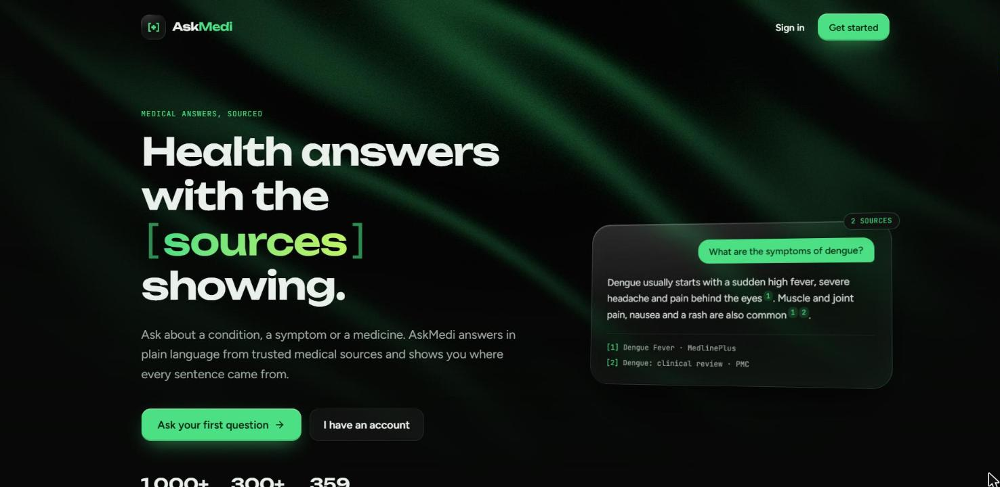
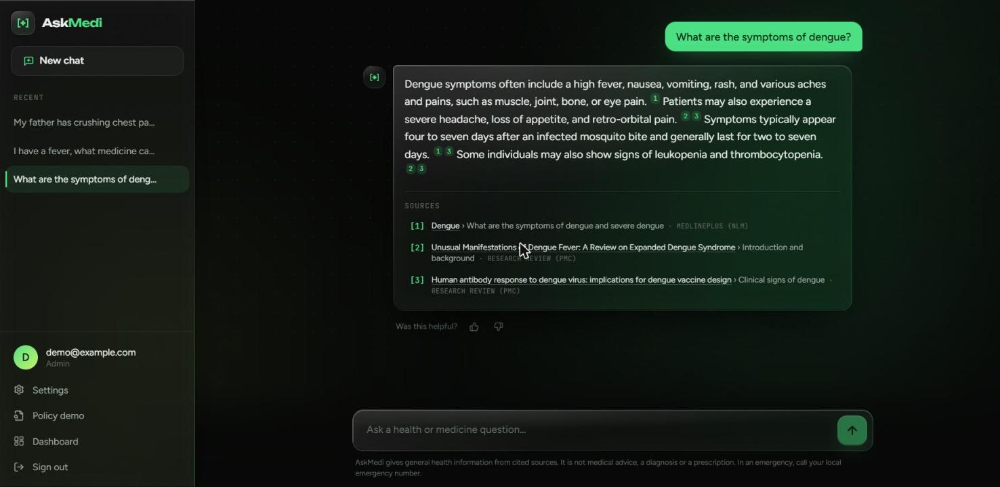
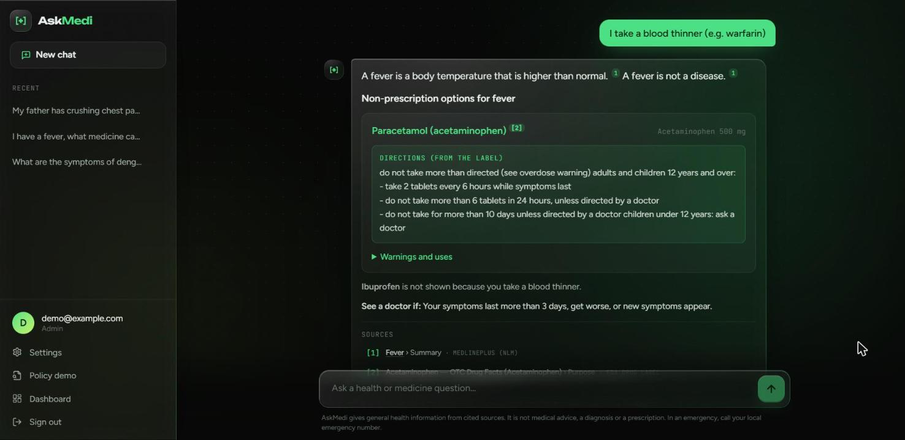
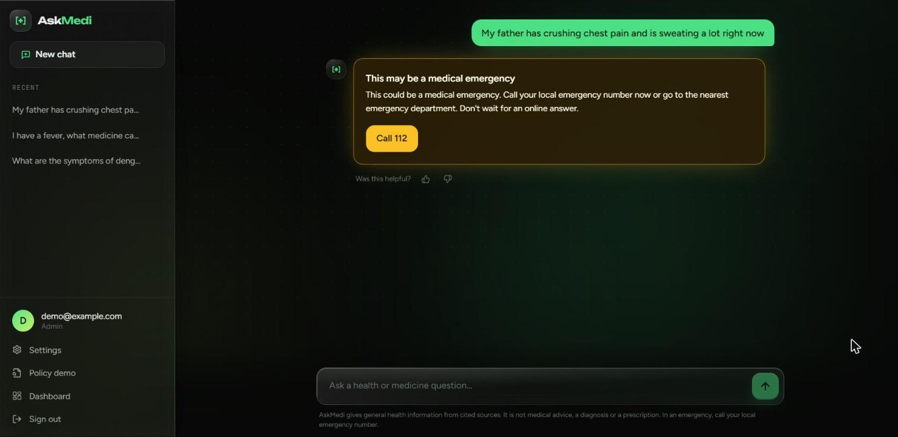
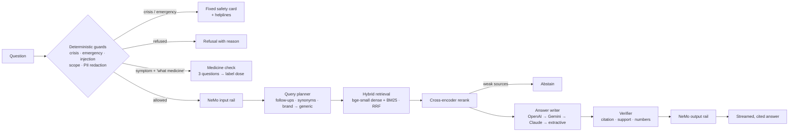
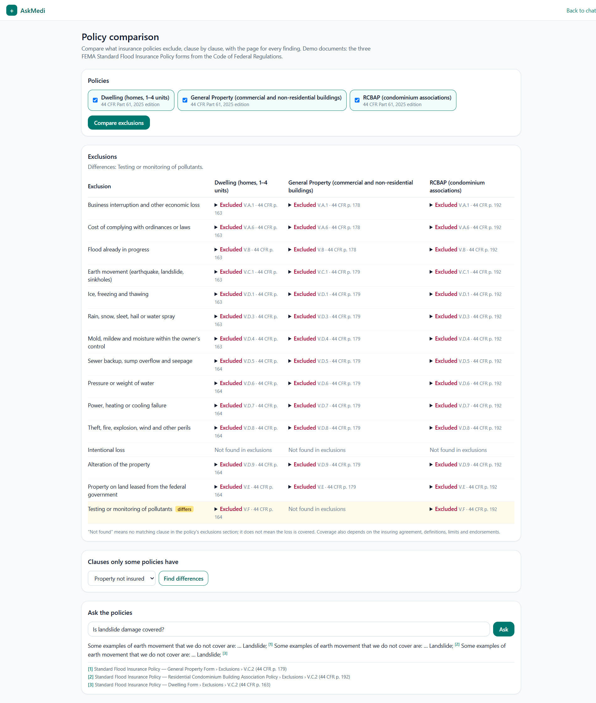
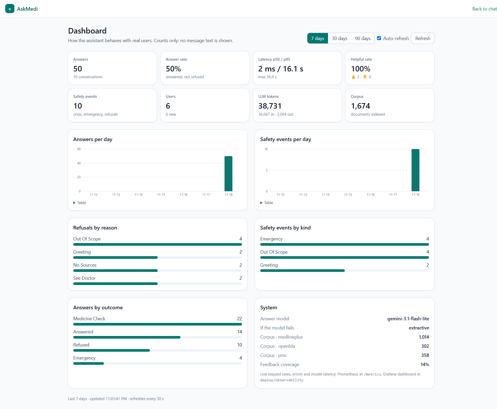
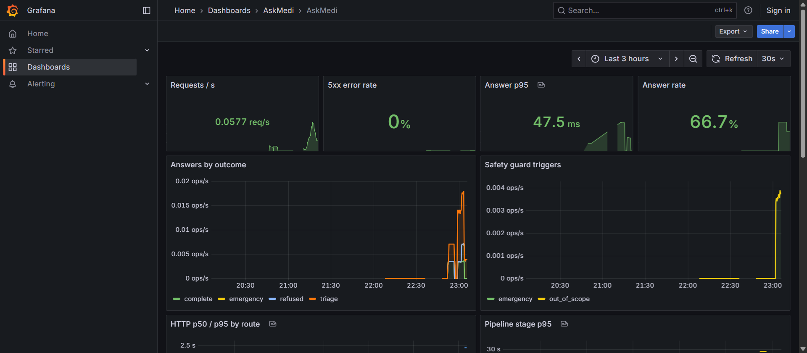

# AskMedi

**A medical question-answering system that cites a source for every sentence, or refuses.**

[](https://github.com/Abhishek764/AskMedi-Medical-Chatbot/actions/workflows/backend.yml)
[](https://github.com/Abhishek764/AskMedi-Medical-Chatbot/actions/workflows/web.yml)


**[▶ Live demo: askmedi-ten.vercel.app](https://askmedi-ten.vercel.app)**. It runs on free
hosting, so the first question after a quiet spell can take about a minute while the API wakes up.

AskMedi answers health questions from 1,677 licence-checked documents (MedlinePlus, FDA drug
labels, PubMed Central reviews). Retrieval is hybrid (dense + BM25 + cross-encoder rerank).
A verifier removes any sentence it can't trace to a passage. Safety runs before any model is
called. When the sources are weak, it says so instead of guessing.





| | |
|---|---|
|  |  |
| **Medicine check.** Three questions, then over-the-counter options with the dose copied verbatim from the FDA label. Here ibuprofen is withheld because the user takes a blood thinner. | **Emergencies skip the AI entirely.** Crisis and emergency messages are caught by deterministic rules in about 0.1 s and get fixed, reviewed copy with tap-to-call numbers. |

## Results

Every number comes from a command in this repo and is rerun in CI where it can be.

| What | Result | How it's measured |
|---|---|---|
| Crisis + emergency recall | **1.00** (10/10) | held-out safety rows written before the guards existed |
| Unsafe requests refused (dosing, diagnosis, jailbreak, off-topic) | **22/22** | same held-out set |
| Expected source cited | **0.93** (356/382) | templated questions over the whole corpus |
| Retrieval recall on hard questions (lay terms, Indian brand names, abbreviations) | **0.872** | 47 hand-written questions, Ragas `IDBasedContextRecall` |
| Answerable questions wrongly refused | **3.4 %** | templated set |
| Sentences shipped without a verified citation | **0** | enforced in code by the verifier |
| Known CVEs in runtime dependencies | **0** | `pip-audit --strict` and `npm audit` in CI |

A **CI eval gate** rebuilds a small index on every pull request. It fails the build if
recall@5 < 0.95, MRR < 0.90, cited-expected-doc < 0.90, or any safety or medicine-routing
check regresses (`evals/ci/thresholds.json`).

**An honest finding.** On templated questions, dense retrieval alone already reaches
0.995 recall@5, so those questions can't tell hybrid search apart from dense. That is why the
hand-written hard set exists. Its misses (for example "Crocin", "Dolo 650", "sunshine vitamin")
are listed in [`evals/results/v2/ragas.md`](evals/results/v2/ragas.md) and drive the next
synonym and brand-name work.

## How an answer is made



- **Cite or refuse.** The verifier drops any sentence whose citation is missing, whose
  passage doesn't support it, or whose numbers don't appear in the source. If nothing survives,
  the user gets a refusal, not a guess.
- **Safety never waits on a model.** Crisis, emergency and injection checks are deterministic
  and run first. They cover first-person risk, methods, fiction framing, Hinglish and leetspeak.
  Risk is sticky for the rest of the conversation.
- **Two layers of guardrails.** NeMo Guardrails adds LLM-judged input and output rails on top
  of the rules. If a rail times out it fails open and is counted, so a provider outage can't
  take the product down.
- **Free by default, better with keys.** Local ONNX models (no GPU, no torch) handle
  embeddings and reranking. The answer writer picks the first provider with a key and falls
  back down the chain. With no key at all, it returns verbatim source sentences.

## Insurance policy comparison

The same cite-or-refuse retrieval applied to a different document type: the three FEMA
Standard Flood Insurance Policy forms (44 CFR Part 61), parsed with their printed page numbers.



- **Exclusions matrix:** every exclusion category across all three policies, with clause and
  page. Differences are flagged (here, testing for pollutants is excluded in two forms but not
  the third).
- **Section diff:** clauses that appear in only some policies.
- **Policy Q&A:** answers quote the clause and cite the page. "Not found" never means "covered".

## Observability

| Layer | What you see |
|---|---|
| **In-app dashboard** (`/admin`) | outcomes, answer rate, p50/p95 latency, refusals by reason, safety events, 👍/👎 rate, tokens, corpus size. Counts only, never message text |
| **Prometheus + Grafana** (`deploy/observability`) | request rate, 5xx rate, latency by route, per-stage latency, LLM calls by outcome (429s, 5xx), tokens, rail verdicts, cache hits |
| **Logfire + LangSmith** | one trace per answer: `input_guard → retrieve → generate → llm <model> → verify → rails`, with token usage per call. Metadata only unless `TRACE_CONTENT=true` |





## Production details

- **API:** FastAPI (async) with SSE streaming. JWT access tokens plus rotating refresh tokens
  in httpOnly cookies, and argon2id password hashing. Email verification, password reset,
  account export and deletion. Per-user rate limits and daily quotas.
- **Data:** PostgreSQL with Alembic migrations (SQLite in dev), Redis for limits, quotas,
  answer cache and the job queue, and an arq worker for ingestion.
- **Corpus pipeline:** fetch → parse → licence gate → parent/child chunking with contextual
  headers → dense + BM25 vectors in Qdrant, with deterministic ids so re-ingesting never
  duplicates. FDA overdose sections are excluded, and PMC articles are checked for licence and
  retraction one by one.
- **Privacy:** PII is redacted before logs, models and traces. Sentry scrubs request bodies.
  The `/metrics` endpoint needs a token outside dev. No HTTP route grants admin.
- **Ops:** Docker, docker-compose, Render blueprint, and GitHub Actions running lint, tests,
  migrations check, dependency audit and the eval gate.
- **Web:** React 19, TypeScript, Vite and Tailwind. Streamed answers with citation links,
  crisis cards with tap-to-call, conversation history.
- **Design:** matte black with one green accent and 3D "liquid glass" panels: bevelled
  highlights, a sheen that follows the pointer, film grain, and an SVG lens that bends the
  background in Chromium. GSAP drives the hero timeline, scroll reveals, 3D card tilt and
  magnetic buttons, all skipped under `prefers-reduced-motion`. Backgrounds are React Bits
  Silk (WebGL, lazy-loaded) on the landing and sign-in pages and CSS-only drifting light in
  the app. Skeleton screens and a top progress bar cover every wait. The `[+]` logo is a
  medical cross held in citation brackets ([concepts](docs/brand/logo-concepts.png)).

## Run it locally

No API keys or paid services needed. Requires [uv](https://docs.astral.sh/uv/) and Node.js 22.

```bash
# API
cd backend
uv sync --extra local                 # add --extra evals --extra rails for Ragas and NeMo
cp .env.example .env                  # set JWT_SECRET; add GEMINI_API_KEY for written answers
uv run python -m app.ingest load      # build the search index from data/corpus
uv run uvicorn app.main:create_app --factory --reload      # http://localhost:8000/docs

# Web (second terminal)
cd web && npm install && npm run dev  # http://localhost:5173

# Optional: Prometheus + Grafana
docker compose -f deploy/observability/docker-compose.yml up -d   # http://localhost:3001
```

| Command | What it does |
|---|---|
| `uv run pytest` / `npm test` | backend and web tests |
| `uv run python -m app.eval_ci` | the CI eval gate |
| `uv run python -m app.eval_ragas [--judge]` | Ragas suite on the hard set |
| `uv run python -m app.eval_ablation` | dense vs BM25 vs hybrid vs hybrid + rerank |
| `uv run python -m app.admin promote you@example.com` | open the `/admin` dashboard |

## Repository layout

```
backend/   FastAPI API, answer pipeline, guards, NeMo rails, ingestion, evals, tests
web/       React app
data/      corpus snapshot (JSONL + manifest) and parsed insurance policies
evals/     golden sets, CI gate thresholds, results (scorecard, ablation, Ragas)
deploy/    single-container image, free Render Blueprint, Prometheus + Grafana stack
docs/      architecture, security analysis, metrics, observability, corpus plan
```

Further reading: [security analysis](docs/security-analysis.md) ·
[metrics and how to move them](docs/METRICS.md) · [observability](docs/OBSERVABILITY.md) ·
[interactive architecture diagram](docs/diagrams/v2-architecture.html) ·
[corpus and licences](data/README.md)

## Disclaimer

AskMedi gives general health information from cited sources. It is not medical advice, a
diagnosis or a prescription, and it is not a medical device. Medicine rules need review by a
clinician before real patients use them. In an emergency, call your local emergency number.
